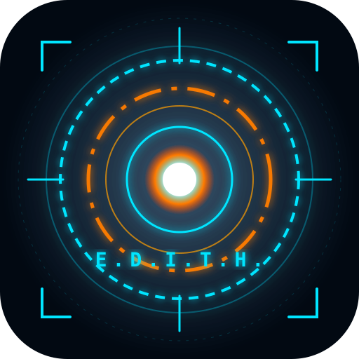

# 🕶️ E.D.I.T.H. — Stark Tactical AI

> **"Even Dead, I'm The Hero"**  
> *Système d'assistance tactique, vocal et personnel inspiré par Tony Stark.*

---

## ⚡ Présentation

**E.D.I.T.H.** est une application web progressive (**PWA**) conçue pour transformer votre smartphone en un terminal d'assistance holographique digne de l'univers Stark Industries :

- 🔵 **Esthétique J.A.R.V.I.S.** : Nuances de bleu cyan holographique (`#00e5ff`) pour l'architecture réseau, les analyses et l'interface HUD.
- 🟠 **Énergie Vision** : Nuances d'orange solaire ambré (`#ff7b00`) pour le noyau ARC central, les réticules de ciblage et la vision tactique.
- 🗣️ **Voix & Écoute E.D.I.T.H.** : Synthèse vocale naturelle et reconnaissance vocale directe en français. Elle vous répond avec le ton calme, précis et dévoué d'E.D.I.T.H.
- 📷 **Vision AR Tactique** : Caméra temps réel avec surcouche HUD holographique et analyse d'image multimodale par IA (Gemini Vision).
- 📱 **Optimisation iPhone Air & iOS** : Intégration Dynamic Island, gestion des Safe Areas (barre Home tactile), noir pur OLED (`#000000`) pour maximiser l'autonomie, accélération fluide 120Hz ProMotion et retours haptiques Taptic Engine.
- 🛠️ **Protocoles & Outils** : Journal de mission (mémos vocaux et écrits), minuteur tactique, télémétrie de l'appareil (batterie, GPS, réseau) et balise de détresse SOS.
- 🧠 **Cerveau IA Multi-Modèles** : Compatible avec **Google Gemini** (1.5 Flash / 2.0 Flash avec vision multimodale), **Groq Cloud** (Llama 3.3 ultra-rapide), **OpenAI** (GPT-4o), ainsi qu'un **Moteur Autonome Hors-Ligne** qui fonctionne sans clé et sans connexion !

---

## 📱 Installation sur Téléphone (PWA)

L'application est optimisée pour être installée directement sur l'écran d'accueil de votre smartphone, sans passer par les stores d'applications :

### Sur iPhone / iPad (Safari) :
1. Ouvrez l'application dans **Safari**.
2. Appuyez sur l'icône **Partager** (le carré avec une flèche vers le haut $\uparrow$ en bas de l'écran).
3. Faites défiler vers le bas et sélectionnez **« Sur l'écran d'accueil »** ➕.
4. Validez en appuyant sur **Ajouter**.  
*L'application s'ouvre désormais en plein écran comme une application native avec son icône Stark.*

### Sur Android (Chrome / Brave / Edge) :
1. Ouvrez l'application dans votre navigateur.
2. Une bannière ou un bouton **« Installer sur mon téléphone »** s'affiche automatiquement.
3. Si ce n'est pas le cas, appuyez sur le menu (les **3 points** en haut à droite) et choisissez **« Installer l'application »** ou **« Ajouter à l'écran d'accueil »**.

---

## 🚀 Fonctionnalités & Utilisation

### 1. Voix HUD & Assistance Globale
- **Parler à E.D.I.T.H.** : Appuyez sur le **Réacteur ARC central** ou sur le bouton microphone orange en bas.
- **Réponse vocale** : E.D.I.T.H. synthétise vocalement sa réponse avec un visualiseur audio d'ondes sinusoïdales interactif.
- **Assistance polyvalente** : Posez-lui n'importe quelle question (stratégie, programmation, sciences, calculs, rédaction, météo, tâches quotidiennes).
- **Puces de commandes rapides** : Lancez des requêtes prédéfinies d'un simple toucher (*"Rapport de situation"*, *"Protocoles tactiques"*, *"Idée Stark"*, etc.).

### 2. Vision Tactique AR (Lunettes E.D.I.T.H.)
- Activez l'onglet **Vision AR** pour déclencher le scanner caméra.
- Visez un objet, un paysage, un document ou un problème technique avec le réticule de ciblage.
- Appuyez sur **« SCANNER LA CIBLE »** : E.D.I.T.H. capture l'image et l'envoie au modèle multimodal Gemini pour une analyse détaillée et lue à voix haute.
- Fonctions intégrées : inversion caméra (avant / arrière) et commande de la torche / flash.

### 3. Protocoles & Outils Tactiques
- **Télémétrie en temps réel** : Suivi de la batterie, liaison réseau, coordonnées géographiques GPS et résolution écran.
- **Minuteur Stark** : Compte à rebours sonore HUD (presets 1 min, 5 min, 15 min, 25 min Pomodoro).
- **Journal de mission** : Sauvegarde instantanée de notes et mémos en mémoire locale (`localStorage`).
- **Balise d'urgence SOS** : Signal stroboscopique visuel et sonore en code Morse.

### 4. Paramètres & Sécurité
- **Fournisseur IA au choix** : Connectez votre clé d'API gratuite Google Gemini (obtenable en 30 secondes sur [Google AI Studio](https://aistudio.google.com/)).
- **Confidentialité totale** : Votre clé API reste stockée uniquement dans votre propre navigateur (`localStorage`) et n'est jamais transmise à un serveur tiers.
- **Mode 100% Hors-Ligne** : Même sans clé API ou en mode avion, le moteur de règles Stark répond instantanément à vos commandes usuelles.

---

## 🛠️ Stack Technique

- **Architecture** : PWA (Progressive Web App) Vanilla HTML5 / CSS3 / ES6 Modules (sans dépendances lourdes, légèreté et vitesse maximales).
- **Design System** : HUD Stark Industries, SVG réactifs, polices *Orbitron* & *Rajdhani*, effets scanlines et néons cyan/orange.
- **Audio Synthesizer** : Web Audio API pour les bruitages sci-fi générés procéduralement sans fichiers externes.
- **Voice IO** : Web Speech API (`SpeechRecognition` + `SpeechSynthesis`).
- **Multimodal AI** : Intégration directe REST API Google Gemini (`gemini-1.5-flash` / `gemini-2.0-flash`).
- **Service Worker** : Caching hors-ligne complet (Cache-First & Stale-While-Revalidate).

---

## 🌐 Déploiement GitHub Pages

Ce projet est prêt à être hébergé directement sur **GitHub Pages** en un clic pour un accès HTTPS instantané sur votre téléphone.

---

*Développé pour honorer l'héritage de Tony Stark. Protocole E.D.I.T.H. MK-V.*
